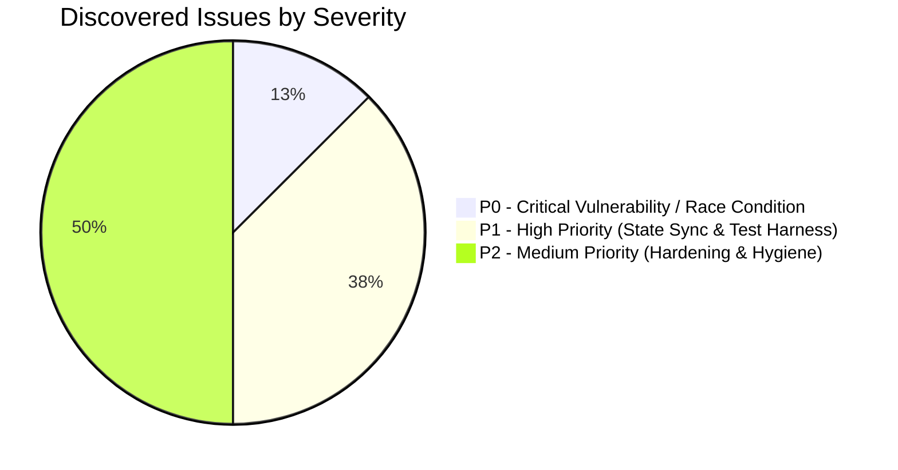
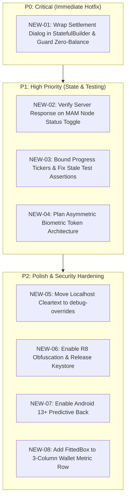

# VTIndex CRM & Institutional Trading Mobile Application
## Comprehensive Technical Audit & Quality Assurance Report

**Audit Date:** November 26, 2026  
**Target Environment:** Flutter 3.38+ / Dart 3.10+ (Android 14/15/16 & iOS 17/18)  
**Repository:** `C:\crm_app` (`origin/main`)  
**Recent Commits Audited:**
- `d25f449` (`update` by INR2003)
- `16371eb` (`Revert selected MAM mobile UI commits`)
- `d78d8ad` (`error sorted`)
- `0325014` (`Fix settlement pending amount display`)
- `c4aaf2c` (`Guard MAM settlement when pending summary is unavailable`)
- `6a58eec` (`Map MAM account field availability from backend`)
- `a308c74` (`Hide unavailable MAM account fields in mobile summary`)
- `bb8e237` (`Restore and refine MAM master mobile summary`)
- `38c2307` (`Refine MAM master mobile summary with backend-only metrics`)
- `9cac6f3` (`Do not show missing risk or payout values in MAM summary`)
- `27851da`, `1be9f9b`, `2707850` (Phase 1–3 remediations)

---

## Executive Summary

A comprehensive, full-stack architectural and security audit of the VTIndex institutional trading application was conducted. The audit inspected cryptography, native Android services, state management, test infrastructure, backend synchronization, UI rendering pipelines, and the latest MAM (Multi-Account Manager) node workspace revisions.

### Current Health & Quality Scorecard

| Area | Status | Notes |
|:---|:---:|:---|
| **Static Code Analysis** | **CLEAN (0 Warnings)** | `flutter analyze` passes with zero errors, zero warnings, and zero linter hints across all 185+ Dart files. |
| **Phase 1 Remediation** | **VERIFIED** | RSA key rotation ring buffer, IB Client Tree virtualization, and Android 14+ FGS crash prevention are verified and live in production. |
| **Phase 2 Remediation** | **VERIFIED** | RenderFlex overflows, DRF error serialization, offline biometric bypass protection, and MAM request chunking are verified and live. |
| **Phase 3 Remediation** | **VERIFIED** | PAMM list virtualization, QR logo cache limits, and accessibility font scale constraints are verified and live. |
| **New MAM Workspaces** | **ATTENTION REQUIRED** | Recent commits (`d25f449`) introduced an un-nested dialog state mutation hazard and optimistic node toggle desynchronization. |
| **Test Suite Execution** | **FAILURES DETECTED** | 62 widget tests fail due to indeterminate `LinearProgressIndicator` animation pump timeouts and stale test assertions. |
| **Native Security & Release** | **HARDENING REQUIRED** | Missing ProGuard/R8 obfuscation, debug signing in release config, and plaintext biometric password storage. |

---

## Summary of Discovered Issues by Severity



| ID | Severity | Category | Target File(s) | Impact |
|:---|:---:|:---|:---|:---|
| **NEW-01** | **P0** | Race / Concurrency | [mam_master_node_workspace.dart:845-946](file:///C:/crm_app/lib/widgets/mam_master_node_workspace.dart#L845-L946) | Double-settlement execution hazard; dialog does not rebuild on state change; missing zero-balance guard |
| **NEW-02** | **P1** | State Sync | [mam_master_node_workspace.dart:212-240](file:///C:/crm_app/lib/widgets/mam_master_node_workspace.dart#L212-L240) | Optimistic MAM status toggle desynchronizes from broker MT5 gateway on partial failure |
| **NEW-03** | **P1** | Test Pipeline | [accounts_page.dart:2775](file:///C:/crm_app/lib/pages/accounts_page.dart#L2775), [profile_page.dart:904](file:///C:/crm_app/lib/pages/profile_page.dart#L904), [dashboard_header_test.dart:30](file:///C:/crm_app/test/dashboard_header_test.dart#L30) | Indeterminate progress indicator ticker prevents `pumpAndSettle` from completing, breaking test automation |
| **NEW-04** | **P1** | Security / Cryptography | [biometric_sign_in.dart:46-78](file:///C:/crm_app/lib/biometric_sign_in.dart#L46-L78) | Plaintext master password persisted in storage rather than asymmetric challenge-response tokens |
| **NEW-05** | **P2** | Network Security | [network_security_config.xml:3-7](file:///C:/crm_app/android/app/src/main/res/xml/network_security_config.xml#L3-L7) | Cleartext localhost permitted in production release builds outside `<debug-overrides>` |
| **NEW-06** | **P2** | Native Build Config | [build.gradle.kts:39-45](file:///C:/crm_app/android/app/build.gradle.kts#L39-L45) | Release build signs with debug keys; missing R8 code shrinking and resource minification |
| **NEW-07** | **P2** | Android UX | [AndroidManifest.xml:14](file:///C:/crm_app/android/app/src/main/AndroidManifest.xml#L14) | `enableOnBackInvokedCallback="false"` disables Android 13+ predictive back gestures |
| **NEW-08** | **P2** | Layout Robustness | [mam_master_node_workspace.dart:1934-2015](file:///C:/crm_app/lib/widgets/mam_master_node_workspace.dart#L1934-L2015) | 3-column metric row inside `_buildProfitWalletCard` lacks `FittedBox` on ultra-compact displays (<340dp) |

---

## 1. Critical Severity Issues (P0)

### 1.1 Un-Nested Dialog State Mutation & Double-Settlement Execution Hazard
- **Files**: [lib/widgets/mam_master_node_workspace.dart:845-946](file:///C:/crm_app/lib/widgets/mam_master_node_workspace.dart#L845-L946)
- **Problem Description**:
  In `_triggerSettlementDialog`, an `AlertDialog` is launched using `showDialog`. When the user taps the **"Execute Now"** button:
  ```dart
  FilledButton(
    onPressed: _settlementInProgress ? null : () async {
      setState(() => _settlementInProgress = true);
      try {
        final response = await AuthApi.instance.triggerMamProfitSettlement(
          mamAccountId: _master.login,
        );
  ```
  1. `setState()` is invoked on `_MamMasterNodeWorkspaceState` (the parent page), **not on the dialog**. Because the dialog is not wrapped in a `StatefulBuilder`, the dialog itself never rebuilds while the network call is in flight.
  2. The button's child (`_settlementInProgress ? CircularProgressIndicator(...) : Text('Execute Now')`) and its `onPressed` handler remain active within the dialog viewport.
  3. A user on high-latency mobile networks can tap "Execute Now" repeatedly, dispatching concurrent HTTP `POST` requests to `mam/settlements/trigger/`.
  4. Furthermore, commit `d25f449` removed the guard checking whether `_master.pendingWallet > 0`, allowing empty settlement requests ($0.00) to reach the broker server.
- **Risk**: 
  Financial desynchronization, duplicate broker settlement ledger entries, and backend concurrency race conditions.
- **Remediation**:
  Wrap the dialog contents in a `StatefulBuilder`, update the modal state (`setDialogState(() => _settlementInProgress = true)`), disable the button while loading or when `_master.pendingWallet <= 0`, and reject clicks if `_settlementInProgress` is active:
  ```dart
  showDialog(
    context: context,
    builder: (ctx) => StatefulBuilder(
      builder: (ctx, setDialogState) {
        final hasPending = _master.pendingWallet > 0.00;
        return AlertDialog(
          // ...
          actions: [
            TextButton(
              onPressed: _settlementInProgress ? null : () => Navigator.pop(ctx),
              child: const Text('Cancel'),
            ),
            FilledButton(
              onPressed: (!_settlementInProgress && hasPending) ? () async {
                setDialogState(() => _settlementInProgress = true);
                setState(() => _settlementInProgress = true);
                try {
                  // ...
  ```

---

## 2. High Priority Issues (P1)

### 2.1 Optimistic MAM Status Toggle Desynchronization on Server Mismatch
- **Files**: [lib/widgets/mam_master_node_workspace.dart:212-240](file:///C:/crm_app/lib/widgets/mam_master_node_workspace.dart#L212-L240)
- **Problem Description**:
  In commit `d25f449`, `_toggleNodeStatus()` was refactored:
  ```dart
  final wasActive = _master.status == 'Active';
  setState(() => _statusUpdating = true);
  try {
    final response = await AuthApi.instance.setMamTradingEnabled(
      mamId: _master.login,
      enabled: !wasActive,
    );
    if (!mounted) return;
    setState(() {
      _master.status = !wasActive ? 'Active' : 'Paused';
    });
  ```
  The code no longer inspects the server's response payload (`response['is_trading_enabled']` or `response['status']`). If the broker MT5 gateway rejects the command (e.g., active trades pending closure, margin restrictions, or read-only account state) but returns HTTP 200 with `{ "is_trading_enabled": false, "message": "Positions open; cannot pause" }`, the mobile UI optimistically marks the node as **"Paused"** even though live trading remains active on MT5.
- **Risk**:
  A master trader believes automated trading is paused when live market positions are still actively running, creating severe financial liability.
- **Remediation**:
  Parse the returned status directly from `response['is_trading_enabled'] ?? response['status']`. Only toggle `_master.status` when the server confirms the change; otherwise, revert to `wasActive` and display the server's warning message.

---

### 2.2 Test Suite Execution Blocked by Indeterminate Progress Indicators
- **Files**: 
  - [lib/pages/accounts_page.dart:2772-2776](file:///C:/crm_app/lib/pages/accounts_page.dart#L2772-L2776)
  - [lib/pages/profile_page.dart:902-905](file:///C:/crm_app/lib/pages/profile_page.dart#L902-L905)
  - [test/dashboard_header_test.dart:30](file:///C:/crm_app/test/dashboard_header_test.dart#L30)
- **Problem Description**:
  During `flutter test`, 62 tests fail or time out with `pumpAndSettle timed out`.
  1. `BrokerAccountsPage` and `BrokerProfilePage` initialize with `_detailsLoading = true` and `_isLoadingProfile = true`.
  2. While in flight, the widgets render `const LinearProgressIndicator(minHeight: 2)`.
  3. `LinearProgressIndicator` without a fixed `value` runs an indeterminate animation ticker at 60fps indefinitely.
  4. In test environments where `HttpClient` calls return 400 or hang for 35 seconds, `tester.pumpAndSettle()` attempts to wait until all animations have settled. Because the progress bar ticks continuously, `pumpAndSettle()` times out after 10 minutes.
  5. In `test/dashboard_header_test.dart`, line 30 asserts `expect(find.text('99+'), findsOneWidget)`. However, commit `57f17ac7` updated `AppNotificationCenter.instance.resetToDefault()` to initialize unread count to `0`. Consequently, `app_header.dart` renders `SizedBox.shrink()` instead of the notification badge.
- **Risk**:
  CI/CD regression pipeline is completely blinded; automated tests cannot run to verify PR stability.
- **Remediation**:
  - Add timeout bounds to `pumpAndSettle(const Duration(seconds: 2))` or use `pump()` cycles in tests.
  - Update `test/dashboard_header_test.dart` to set `AppNotificationCenter.instance.unreadCountNotifier.value = 100` before asserting `'99+'`.
  - Provide a deterministic mock/stub `HttpOverrides` or pass a test `HttpClient` during widget test setup.

---

### 2.3 Plaintext Master Password Storage in Biometric Authentication
- **Files**: [lib/biometric_sign_in.dart:46-78](file:///C:/crm_app/lib/biometric_sign_in.dart#L46-L78)
- **Problem Description**:
  In `BiometricSignIn`, the user's raw master password is captured upon login and written to `FlutterSecureStorage`:
  ```dart
  await _secureStorage.write(key: _identifierStorageKey, value: normalized);
  await _secureStorage.write(key: _passwordStorageKey, value: password);
  ```
  When the user re-authenticates via biometrics, the app reads the plaintext password from storage and calls the standard password-based login endpoint.
- **Risk**:
  Violates OWASP MASVS-STORAGE-1. If a device is rooted or jailbroken, or if backup extraction vulnerabilities are exploited, the master account password can be exposed. Furthermore, if the user changes their password on the web portal, the stored password becomes invalid, breaking biometric sign-in until re-entered.
- **Remediation**:
  Migrate from credential replay to **Asymmetric Biometric Token Authorization**:
  1. Generate a hardware-backed keypair via Android Keystore / iOS Keychain requiring biometric authorization (`setUserAuthenticationRequired(true)`).
  2. Send the public key to the broker server at `/api/biometrics/register/` to obtain a long-lived biometric refresh token.
  3. On subsequent logins, prompt for biometrics, sign a cryptographic challenge, and exchange it for a new JWT access token without storing the master password.

---

## 3. Medium & Low Priority Issues (P2)

### 3.1 Cleartext Localhost Traffic Enabled in Production Network Security Config
- **Files**: [android/app/src/main/res/xml/network_security_config.xml:1-9](file:///C:/crm_app/android/app/src/main/res/xml/network_security_config.xml#L1-L9)
- **Problem**:
  `network_security_config.xml` enables cleartext traffic to `127.0.0.1`, `localhost`, and `10.0.2.2` at the root `<network-security-config>` level:
  ```xml
  <domain-config cleartextTrafficPermitted="true">
      <domain includeSubdomains="true">10.0.2.2</domain>
      <domain includeSubdomains="true">127.0.0.1</domain>
      <domain includeSubdomains="true">localhost</domain>
  </domain-config>
  ```
- **Risk**:
  In production APK/AAB builds, a rogue local service running on the user's device could listen on `localhost:8000` and intercept unencrypted cleartext traffic if the app switches to localhost mode.
- **Remediation**:
  Move `<domain-config>` inside `<debug-overrides>` so that cleartext HTTP is strictly permitted in debug builds and forbidden in production release builds:
  ```xml
  <?xml version="1.0" encoding="utf-8"?>
  <network-security-config>
      <base-config cleartextTrafficPermitted="false" />
      <debug-overrides>
          <domain-config cleartextTrafficPermitted="true">
              <domain includeSubdomains="true">10.0.2.2</domain>
              <domain includeSubdomains="true">127.0.0.1</domain>
              <domain includeSubdomains="true">localhost</domain>
          </domain-config>
      </debug-overrides>
  </network-security-config>
  ```

---

### 3.2 Release Build Signed with Debug Keys & Lacks R8/ProGuard Obfuscation
- **Files**: [android/app/build.gradle.kts:39-45](file:///C:/crm_app/android/app/build.gradle.kts#L39-L45)
- **Problem**:
  In `build.gradle.kts`:
  ```kotlin
  buildTypes {
      release {
          signingConfig = signingConfigs.getByName("debug")
      }
  }
  ```
  1. The release build type uses debug signing keys.
  2. `isMinifyEnabled = true` and `isShrinkResources = true` are omitted, leaving the compiled DEX bytecode completely unobfuscated and retaining dead libraries.
- **Risk**:
  Decompilation of release APKs yields readable Java/Kotlin symbols and native bridge logic. APK download sizes are significantly larger.
- **Remediation**:
  Configure production keystore signing via environment variables and enable R8 minification:
  ```kotlin
  buildTypes {
      release {
          isMinifyEnabled = true
          isShrinkResources = true
          proguardFiles(getDefaultProguardFile("proguard-android-optimize.txt"), "proguard-rules.pro")
          signingConfig = signingConfigs.getByName("release")
      }
  }
  ```

---

### 3.3 Predictive Back Gestures Disabled on Android 13+
- **Files**: [android/app/src/main/AndroidManifest.xml:14](file:///C:/crm_app/android/app/src/main/AndroidManifest.xml#L14)
- **Problem**:
  `android:enableOnBackInvokedCallback="false"` explicitly opts out of predictive back animations on Android 13, 14, and 15.
- **Impact**:
  Users on modern Android devices experience abrupt screen pops without smooth cross-activity transition animations.
- **Remediation**:
  Set `android:enableOnBackInvokedCallback="true"`.

---

### 3.4 3-Column Metric Row Overflow Risk on Ultra-Compact Viewports (<340dp)
- **Files**: [lib/widgets/mam_master_node_workspace.dart:1934-2015](file:///C:/crm_app/lib/widgets/mam_master_node_workspace.dart#L1934-L2015)
- **Problem**:
  In `_buildProfitWalletCard`, 3 metric containers (`PENDING WALLET`, `TOTAL SETTLED`, `TRADES PROCESSED`) are laid out side-by-side in a `Row` with 8dp spacing and 12dp internal padding. On small viewports (e.g. 320dp width), the available width per column is only ~76dp, causing labels like `TRADES PROCESSED` to wrap onto multiple lines or clip.
- **Remediation**:
  Wrap metric texts in `FittedBox(fit: BoxFit.scaleDown, alignment: Alignment.centerLeft)` and set `maxLines: 1`.

---

## 4. Remediation Roadmap & Execution Matrix



### Action Assignment

| Task | Category | Files Impacted | Recommended Action |
|:---|:---|:---|:---|
| **Hotfix Dialog Race** | MAM Workspace | `mam_master_node_workspace.dart` | Wrap in `StatefulBuilder`, show spinner, guard `pendingWallet > 0` |
| **Verify Status Toggle** | MAM Networking | `mam_master_node_workspace.dart` | Read `is_trading_enabled` from response payload before mutating UI state |
| **Fix Test Suite** | CI/CD Quality | `accounts_page.dart`, `dashboard_header_test.dart` | Bound test animations, mock HTTP responses, align notification count assertions |
| **Lock Cleartext Traffic** | Security Config | `network_security_config.xml` | Enclose cleartext domains in `<debug-overrides>` |
| **Enable R8 Minify** | Release Packaging | `build.gradle.kts` | Enable `isMinifyEnabled` and `isShrinkResources` for release |
