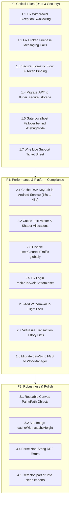

# Comprehensive Application Audit Report: VTIndex Institutional CRM & Trading Portal

**Application**: VTIndex Flutter Client & Android Native Integration (`C:\crm_app`)  
**Scope**: Frontend UI/UX, Backend Networking & API Contracts, Cryptography, Security & Data Storage, Native Android (`MainActivity.kt`, `TradeLiveUpdateService.kt`), and Background Synchronization.  
**Auditors**: Frontend Performance Auditor & Backend/Security Auditor  
**Date**: November 25, 2026  
**Repository Branch**: `main`

---

## Executive Summary & Scorecard

A full architectural, security, and performance audit was conducted across the entire codebase (~45,000 lines of Dart and Kotlin).

| Domain | Status | Key Risk |
|---|:---:|---|
| **Data Integrity & Transactions** | 🔴 **Critical** | Silent withdrawal exception swallowing presenting fake success receipts. |
| **Authentication & Biometrics** | 🔴 **Critical** | Biometric bypass without cryptographic token binding; plaintext JWT storage. |
| **Runtime Stability** | 🔴 **Critical** | Non-existent Firebase Messaging method calls will crash push notification flows. |
| **Android Background Platform** | 🔴 **Critical** | Android 14/15 `dataSync` 6-hour timeout termination & Google Play policy violation. |
| **Network & Cryptography** | 🟠 **High** | Insecure cleartext localhost failover; 15s 2048-bit RSA keygen CPU/battery drain. |
| **Rendering & Virtualization** | 🟡 **Medium** | TextPainter allocations inside `paint()` loops; nested `ListView(shrinkWrap: true)`. |
| **Code Architecture** | 🟡 **Medium** | Monolithic files (3,000–5,000 lines each) and `part of 'main.dart'` namespace pollution. |

---

## 1. Critical Severity Issues (P0 — Immediate Action Required)

### 1.1 Silent Failure Swallowed in Withdrawal Flow Presenting Fake Success Receipt
- **File**: [lib/pages/funds_action_dialog.dart:2342-2386](file:///C:/crm_app/lib/pages/funds_action_dialog.dart#L2342-L2386)
- **Problem**: When a client confirms a fund withdrawal, `AuthApi.instance.requestWithdrawal` is executed inside a `try-catch` with an empty catch block (`catch (_) {}`). Regardless of whether the backend returns a 500 server error, network timeout, or insufficient balance rejection:
  1. The code generates a client-side fake reference ID (`VTX-WTH-...`).
  2. Dispatches a success push notification via `AppNotificationCenter`.
  3. Displays `_showWithdrawReceiptModal` declaring the withdrawal submitted.
- **Impact**: The user is falsely told their withdrawal succeeded while no money moved and the server transaction failed.
- **Remediation**: Capture `AuthApiException`, abort receipt modal on failure, and display error toast:
  ```dart
  try {
    final res = await AuthApi.instance.requestWithdrawal(...);
    final refId = res['transaction_id'] != null 
        ? 'VTX-WTH-${res['transaction_id']}' 
        : 'VTX-WTH-${DateTime.now().millisecondsSinceEpoch}';
    _showWithdrawReceiptModal(context, referenceId: refId, ...);
  } on AuthApiException catch (e) {
    showAppMessage(e.message);
  } catch (e) {
    showAppMessage('Withdrawal request failed. Please check your connection.');
  }
  ```

---

### 1.2 Invalid Firebase Messaging Method Calls Will Cause Runtime Crash
- **Files**: [lib/push_messaging.dart:36-43](file:///C:/crm_app/lib/push_messaging.dart#L36-L43), [lib/services/auth_api.dart:616-620](file:///C:/crm_app/lib/services/auth_api.dart#L616-L620)
- **Problem**: In `push_messaging.dart` and `auth_api.dart`, the code calls:
  ```dart
  _tokenSubscription = FirebaseMessaging.instance.onRegistered.listen(...);
  await FirebaseMessaging.instance.register();
  ```
  Neither `onRegistered` nor `register()` exist in the official `firebase_messaging` Flutter plugin. The correct API methods are `FirebaseMessaging.instance.onTokenRefresh` and `FirebaseMessaging.instance.getToken()`.
- **Impact**: As soon as push notifications initialize on device, the app throws a fatal `NoSuchMethodError` or compile failure.
- **Remediation**:
  ```dart
  _tokenSubscription = FirebaseMessaging.instance.onTokenRefresh.listen((token) {
    if (token.isNotEmpty) unawaited(_registerToken(token));
  });
  final token = await FirebaseMessaging.instance.getToken();
  if (token != null && token.isNotEmpty) unawaited(_registerToken(token));
  ```

---

### 1.3 Complete Biometric Authentication Bypass (No Cryptographic Token Binding)
- **Files**: [lib/biometric_sign_in.dart:10-47](file:///C:/crm_app/lib/biometric_sign_in.dart#L10-L47), [lib/pages/login_page.dart:165-175](file:///C:/crm_app/lib/pages/login_page.dart#L165-L175), [lib/main.dart:211-246](file:///C:/crm_app/lib/main.dart#L211-L246)
- **Problem**: 
  1. `BiometricSignIn` uses `local_auth` merely as a boolean gate.
  2. In `login_page.dart`, when `authenticated == true`, it immediately invokes `widget.onLogin?.call()`.
  3. `onLogin` directly triggers `_openDashboard()`, replacing the route with `AppShell`.
  4. **The app enters the authenticated dashboard WITHOUT decrypting an access token or validating credentials against the backend.**
  5. Any enrolled fingerprint on a shared or stolen device can bypass the login form. If the session expired or token is invalid, the dashboard enters an inconsistent broken state.
- **Remediation**: Biometric prompt must decrypt the access token stored in the Android Keystore / iOS Keychain (via `flutter_secure_storage`), verify token validity with `AuthApi.instance.validateSession()`, and only then open the dashboard.

---

### 1.4 Plaintext JWT Access Token Storage in SharedPreferences
- **Files**: [lib/services/auth_api.dart:129-165](file:///C:/crm_app/lib/services/auth_api.dart#L129-L165), [android/app/src/main/kotlin/com/example/crm_app/TradeLiveUpdateService.kt:102-107](file:///C:/crm_app/android/app/src/main/kotlin/com/example/crm_app/TradeLiveUpdateService.kt#L102-L107)
- **Problem**: The client persists the JWT access token in standard `SharedPreferences`. In Android, this writes to an unencrypted XML file at `/data/data/com.example.crm_app/shared_prefs/FlutterSharedPreferences.xml`. In `TradeLiveUpdateService.kt`, the native service reads this plaintext file directly:
  ```kotlin
  val accessToken = getSharedPreferences("FlutterSharedPreferences", Context.MODE_PRIVATE)
      .getString("flutter.vtindex_client_access_token", null)
  ```
  On rooted devices or via Android backup extraction, the plaintext JWT token can be extracted.
- **Remediation**: Add `flutter_secure_storage` to encrypt tokens with hardware-backed Android Keystore / iOS Keychain. Pass the active token to `TradeLiveUpdateService` via in-memory Intent extras rather than reading raw XML files.

---

### 1.5 Insecure Automatic Base URL Failover to Cleartext Localhost in Production
- **File**: [lib/services/auth_api.dart:318-344](file:///C:/crm_app/lib/services/auth_api.dart#L318-L344)
- **Problem**: When `_configuredBaseUrl` is empty, if an API call encounters a connection timeout or packet drop, `_isNetworkConnectionError()` triggers:
  ```dart
  final fallbackUri = _useLocalhost ? _productionBaseUri : _localBaseUri;
  ...
  _useLocalhost = !_useLocalhost;
  ```
  If a mobile user experiences brief Wi-Fi or cellular interruption, the app automatically switches `_useLocalhost = true`, pointing subsequent requests to `http://10.0.2.2:8000` or `http://127.0.0.1:8000`. All future authenticated requests (with live tokens and trade operations) are redirected to an unencrypted local socket, breaking the app until restart.
- **Remediation**: Strictly gate the localhost fallback behind `if (kDebugMode)`. Production release builds must only target `https://client.hi5trader.com`.

---

### 1.6 Android 14/15 Foreground Service Policy Violation & 6-Hour Timeout Crash
- **Files**: [android/app/src/main/AndroidManifest.xml:4, 16](file:///C:/crm_app/android/app/src/main/AndroidManifest.xml#L4), [android/app/src/main/kotlin/com/example/crm_app/TradeLiveUpdateService.kt:82, 375-377](file:///C:/crm_app/android/app/src/main/kotlin/com/example/crm_app/TradeLiveUpdateService.kt#L82)
- **Problem**:
  1. `TradeLiveUpdateService` is declared with `android:foregroundServiceType="dataSync"`. Under Google Play Policy for Android 14+ (API 34+), `dataSync` is restricted to active file transfers. Continuous background polling under `dataSync` will cause Google Play rejection.
  2. Starting in Android 15 (API 35), `dataSync` foreground services have a strict **6-hour runtime quota**. Line 375 defines `onTimeout(startId: Int, fgsType: Int) { stopSelf(startId) }`. After 6 hours, the operating system forcibly terminates the service.
- **Remediation**: Migrate background portfolio synchronization to Android `WorkManager` with periodic execution constraints, or push real-time updates via Firebase Cloud Messaging (FCM) high-priority data messages.

---

### 1.7 Header Support Ticket Request Sheet is a Dead-End Mock
- **Files**: [lib/widgets/app_header.dart:402-404](file:///C:/crm_app/lib/widgets/app_header.dart#L402-L404), [lib/pages/support_legal_pages.dart:737-743](file:///C:/crm_app/lib/pages/support_legal_pages.dart#L737-L743)
- **Problem**: In `app_header.dart`, clicking "Submit a Ticket" opens `_TicketRequestSheet`. On submit, it only pops the sheet and displays a toast without calling the backend. Meanwhile, a fully functional `_LiveTicketRequestSheet` exists in `support_legal_pages.dart` but is completely bypassed.
- **Remediation**: Rewire `_showCreateTicketSheet` in `app_header.dart` to open `_LiveTicketRequestSheet` or navigate to `BrokerTicketsPage`.

---

## 2. High Severity Issues (P1 — Core Operational & Performance Risks)

### 2.1 Excessive CPU & Battery Drain: 2048-bit RSA Keygen Every 15 Seconds in Native Service
- **File**: [android/app/src/main/kotlin/com/example/crm_app/TradeLiveUpdateService.kt:95, 193-203, 258-260](file:///C:/crm_app/android/app/src/main/kotlin/com/example/crm_app/TradeLiveUpdateService.kt#L95)
- **Problem**: The native Android service polls every 15 seconds. In each cycle, for every single account in the portfolio, it runs:
  ```kotlin
  val responseKeyPair = createResponseKeyPair() // KeyPairGenerator RSA 2048
  ```
  Generating a 2048-bit RSA key pair requires intensive prime number generation. Repeating this 20+ times per minute on a mobile CPU drains the device battery and causes thermal throttling.
- **Remediation**: Cache the `KeyPair` at the service instance level, rotating it once every 15–30 minutes, or align the polling rate to 45s.

---

### 2.2 Text Shaping & Dynamic Allocation in CustomPainter `paint()` Loops
- **Files**: [lib/pages/trade_report_page.dart:1875-1899, 1950-1956](file:///C:/crm_app/lib/pages/trade_report_page.dart#L1875-L1899), [lib/pages/login_page.dart:1916-1930](file:///C:/crm_app/lib/pages/login_page.dart#L1916-L1930)
- **Problem**: In `_TradeReportLinePainter`, `_TradeReportBarPainter`, and `_LoginBackgroundPainter`, `TextPainter()` instances are instantiated and `.layout()` is called inside a loop on **every paint frame**. Text layout and font shaping are CPU-intensive operations that drop frame rates from 60fps/120fps down to 20-30fps during scrolling.
- **Remediation**: Pre-layout and cache `TextPainter` instances or render label grids using lightweight Flutter widgets (`Row`, `Text`) overlaid on the canvas.

---

### 2.3 Global Cleartext HTTP Traffic Allowed in Android Manifest
- **File**: [android/app/src/main/AndroidManifest.xml:15](file:///C:/crm_app/android/app/src/main/AndroidManifest.xml#L15)
- **Problem**: `android:usesCleartextTraffic="true"` is declared globally on `<application>`. This disables Android's default cleartext protection for all network calls across the app.
- **Remediation**: Set `android:usesCleartextTraffic="false"` and configure `res/xml/network_security_config.xml` to allow cleartext solely for `10.0.2.2` in `debug` builds.

---

### 2.4 Complete Absence of SSL/TLS Certificate Pinning
- **Files**: [lib/services/auth_http_client_stub.dart:3](file:///C:/crm_app/lib/services/auth_http_client_stub.dart#L3), [android/app/src/main/kotlin/com/example/crm_app/TradeLiveUpdateService.kt:194-206](file:///C:/crm_app/android/app/src/main/kotlin/com/example/crm_app/TradeLiveUpdateService.kt#L194-L206)
- **Problem**: Both Dart (`createAuthHttpClient()` returns default `http.Client()`) and Kotlin (`HttpURLConnection`) rely entirely on the device CA trust store. For a financial application executing trade orders and managing institutional capital, this leaves connections vulnerable to MITM interception on compromised Wi-Fi networks.
- **Remediation**: Implement SSL Public Key Pinning (SPKI) using Dart's `SecurityContext` and Android's `<pin-set>` in `network_security_config.xml`.

---

### 2.5 Keyboard Inset Occlusion via `resizeToAvoidBottomInset: false`
- **File**: [lib/pages/login_page.dart:539-565](file:///C:/crm_app/lib/pages/login_page.dart#L539-L565)
- **Problem**: `LoginPage` sets `resizeToAvoidBottomInset: false` on the Scaffold. When the software keyboard opens on screens $\le$ 6.1 inches, in landscape mode, or with display scaling enabled, the keyboard obscures the password field and sign-in button with no ability to scroll them into view.
- **Remediation**: Remove `resizeToAvoidBottomInset: false`. Keep the decorative background stationary with `Positioned.fill` inside a `Stack` and allow the form `SingleChildScrollView` to inset naturally.

---

### 2.6 Missing In-Flight Submission Guard on Withdrawals
- **File**: [lib/pages/funds_action_dialog.dart:2176-2199, 2811](file:///C:/crm_app/lib/pages/funds_action_dialog.dart#L2176-L2199)
- **Problem**: In `_BrokerFundsPageState._submit()`, if `withdrawal == true`, it opens `_showWithdrawConfirmationSheet` without locking `_isSubmitting = true`. Inside `_WithdrawConfirmationSheet`, the confirm button does not disable itself or set a debounce flag during the async HTTP call. Rapid double-tapping can dispatch duplicate withdrawal requests to the MT5 gateway.
- **Remediation**: Set `_isSubmitting = true` before opening the sheet and disable the confirm button on first click.

---

### 2.7 Viewport Virtualization Disabled by Nested `ListView(shrinkWrap: true)`
- **File**: [lib/pages/broker_screens.dart:3866, 4344, 4781](file:///C:/crm_app/lib/pages/broker_screens.dart#L3866) (`BrokerTransactionsPage`)
- **Problem**: Open positions, closed positions, and account transaction histories use nested `ListView.builder(shrinkWrap: true, physics: const NeverScrollableScrollPhysics())` inside an outer `ListView`. This forces double-layout measurement passes and instantiates all 100+ transaction cards in memory at once.
- **Remediation**: Replace with a unified `CustomScrollView` utilizing `SliverList.builder`.

---

### 2.8 Indefinite RSA Session Key Caching Without Rotation
- **File**: [lib/services/auth_api.dart:134-135, 396-422, 433-437](file:///C:/crm_app/lib/services/auth_api.dart#L134-L135)
- **Problem**: The session RSA-2048 keypair generated in Phase 1 is cached in `_cachedSessionKeyPair`. Line 426 explicitly checks:
  ```dart
  void _cleanupResponseKeyPair(String keyId) {
    if (_cachedSessionKeyPair?.keyId != keyId) {
      _responseEncryptionPrivateKeys.remove(keyId);
    }
  }
  ```
  Because the key matches `_cachedSessionKeyPair?.keyId`, it is never cleared and is reused across thousands of requests until app termination, reducing forward secrecy.
- **Remediation**: Implement automated key rotation every 100 requests or 30 minutes.

---

### 2.9 Missing `POST_NOTIFICATIONS` Permission Guard Before Launching Service
- **File**: [android/app/src/main/kotlin/com/example/crm_app/MainActivity.kt:91-109](file:///C:/crm_app/android/app/src/main/kotlin/com/example/crm_app/MainActivity.kt#L91-L109)
- **Problem**: In `MainActivity.kt`, `startPositionService` starts `TradeLiveUpdateService` via `ContextCompat.startForegroundService()` without checking if `android.permission.POST_NOTIFICATIONS` has been granted. On Android 13+ (API 33+), the notification is suppressed, and foreground service execution may be restricted by the OS.
- **Remediation**: Verify permission before launching or prompt the user via Flutter.

---

## 3. Medium & Low Severity Issues (P2 — Robustness & Polish)

| ID | Severity | File & Location | Description | Recommendation |
|---|:---:|---|---|---|
| **3.1** | **Medium** | [accounts_page.dart:343-356](file:///C:/crm_app/lib/pages/accounts_page.dart#L343-L356), [broker_screens.dart:326](file:///C:/crm_app/lib/pages/broker_screens.dart#L326) | `Path()`, `Paint()`, and `Shader` allocated every frame inside `paint()` loops causing GC pressure. | Allocate reusable `Paint` and `Path` as fields on the painter and call `.reset()`. |
| **3.2** | **Medium** | [more_page.dart:223-228](file:///C:/crm_app/lib/pages/more_page.dart#L223-L228) | High-res logo assets (1024x1024) loaded in 40x40 circle avatars without `cacheWidth`/`cacheHeight`. | Add `cacheWidth: 120, cacheHeight: 120` to `Image.asset`. |
| **3.3** | **Medium** | [auth_api.dart:452](file:///C:/crm_app/lib/services/auth_api.dart#L452), [TradeLiveUpdateService.kt:269](file:///C:/crm_app/android/app/src/main/kotlin/com/example/crm_app/TradeLiveUpdateService.kt#L269) | Static hardcoded string `'vtindex:user-info:v1'` used as AAD across unrelated endpoints. | Bind AAD to endpoint and account context: `vtindex:${endpoint}:${accountId}`. |
| **3.4** | **Medium** | [auth_api.dart:378-385](file:///C:/crm_app/lib/services/auth_api.dart#L378-L385) | `hasErrorMessage = data['error'] is String`; DRF map errors (e.g. `{"error": {...}}`) ignored. | Update to `data['error'] != null && data['error'] != false`. |
| **3.5** | **Medium** | [accounts_page.dart:731-750](file:///C:/crm_app/lib/pages/accounts_page.dart#L731-L750) | Trading group fetching failure swallowed silently; dropdown remains empty with no error state. | Display error banner with a "Retry" button when `_groups.isEmpty`. |
| **3.6** | **Medium** | [main.dart:580-600](file:///C:/crm_app/lib/main.dart#L580-L600) | Notification and deep-link click handlers await async operations without `if (!mounted) return;`. | Add `if (!mounted) return;` guard before all `setState()` calls. |
| **3.7** | **Medium** | [MainActivity.kt:114-131](file:///C:/crm_app/android/app/src/main/kotlin/com/example/crm_app/MainActivity.kt#L114-L131) | Synchronous `getSharedPreferences().edit().apply()` on Android UI thread in MethodChannel. | Dispatch disk I/O to Kotlin Coroutines on `Dispatchers.IO`. |
| **3.8** | **Low** | [dashboard_page.dart:340-365](file:///C:/crm_app/lib/pages/dashboard_page.dart#L340-L365) | Fixed width `SizedBox(width: 140)` items overflow on small screens (<360dp). | Wrap with `Wrap` or use `Expanded` with `FittedBox`. |
| **3.9** | **Low** | [MainActivity.kt:143-148](file:///C:/crm_app/android/app/src/main/kotlin/com/example/crm_app/MainActivity.kt#L143-L148) | Deprecated `windowManager.defaultDisplay` and `preferredRefreshRate` (deprecated in API 30). | Use `context.display` and `preferredDisplayModeId`. |
| **3.10**| **Low** | [app_header.dart:280-310](file:///C:/crm_app/lib/widgets/app_header.dart#L280-L310) | Custom header icon buttons lack `tooltip` or `Semantics` tags. | Add accessibility tooltips for screen readers. |

---

## 4. Architectural Findings & Code Health

### 4.1 Namespace Pollution via `part of 'main.dart'`
- **Problem**: 12 critical pages (`accounts_page.dart`, `broker_screens.dart`, `dashboard_page.dart`, `login_page.dart`, etc.) are linked into `main.dart` using Dart's `part` / `part of` directive.
- **Risk**: All private (`_` prefixed) methods, classes, and top-level variables share a single global library scope. This previously caused the `_PortfolioLinePainter is already declared in this scope` build failure.
- **Recommendation**: Convert `part` files into independent Dart library modules using standard `import` statements and explicit public exports.

### 4.2 Monolithic "God Files"
- **Problem**: Multiple page files exceed 3,500 lines:
  - `broker_screens.dart`: 5,760 lines
  - `partnership_page.dart`: 5,553 lines
  - `pamm_page.dart`: 4,164 lines
  - `login_page.dart`: 3,702 lines
  - `mam_page.dart`: 3,670 lines
- **Risk**: High risk of unintended regression, slow IDE indexing, and difficulty isolating widget rebuild scopes.
- **Recommendation**: Split giant files into modular folder structures (e.g., `lib/pages/pamm/widgets/`, `lib/pages/pamm/models/`).

---

## 5. Prioritized Remediation Roadmap


