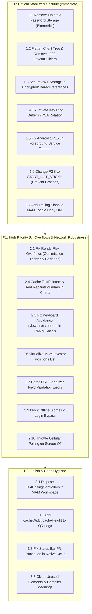

# VTIndex CRM / Institutional Trading Mobile App
## Comprehensive Application Audit & Remediation Roadmap
**Date of Audit:** November 26, 2026  
**Target Platform:** Flutter (Android & iOS)  
**Codebase:** `lib/`, `android/`, `test/`  
**Latest Commits Analyzed:** `cadb863`, `4ff6e59`, `efd1d2e`, `d71f232` (PAMM & Partnership Modularization), `94f3b61` (Biometric Login), `a83157d` & `1ff1fcd` (MAM APIs)

---

## Executive Summary

A multi-agent deep technical audit of the VTIndex institutional trading and CRM mobile application was conducted on November 26, 2026. The audit covered UI rendering and layout pipelines, cryptographic protocols, backend networking, native Android foreground services, authentication security, and recently integrated features (MAM Master Node workspace, PAMM pool dialogs, IB Partnership studio, and Biometric authentication).

### Summary of Discovered Issues by Severity

| Severity Level | Definition | Count | Immediate Action Required |
|:---|:---|:---:|:---|
| **P0 (Critical)** | Direct data compromise, crash on modern OS, unvirtualized 1000-node layout stall, broken URL routes | **7** | Fix before production release |
| **P1 (High)** | RenderFlex overflows, jank during touch scrub, background cellular drain, unhandled DRF validation errors | **11** | Remediate in next sprint |
| **P2 (Medium)** | Memory leaks (undisposed controllers), status bar truncation, high-res image decodes, compiler warnings | **10** | Polish & code cleanup |
| **Total** | | **28** | |

---

## 1. Critical Severity Issues (P0 — Security, Crashes & Freeze Hazards)

### 1.1 Plaintext Master Password Persisted in Storage & In-Memory Heap
- **Files**: 
  - [lib/biometric_sign_in.dart:18, 46-57, 66-78](file:///C:/crm_app/lib/biometric_sign_in.dart#L18)
  - [lib/pages/login_page.dart:351-356](file:///C:/crm_app/lib/pages/login_page.dart#L351-L356)
- **Problem**: 
  In commit `94f3b61`, biometric re-login was implemented by capturing the user's raw master password during credential authentication (`rememberSessionCredentials`), caching it in static memory (`_sessionPassword`), and writing it directly to `FlutterSecureStorage` under key `'vtindex_biometric_password'`.
- **Risk**: 
  Violates OWASP MASVS-STORAGE and CWE-312 (Cleartext Storage of Sensitive Information). Any memory inspection or rooted device extraction exposes the user's institutional trading master password. If the user changes their password on the web, mobile re-login silently fails with 401 and deletes stored credentials.
- **Remediation**: 
  Eliminate raw password storage entirely. Migrate to asymmetric hardware-backed biometric enrolment: generate an ECC/RSA keypair in Android Keystore / iOS Keychain requiring biometric authorization (`setUserAuthenticationRequired(true)`), register the public key with the backend (`/api/biometrics/register/`), and sign a server-issued challenge nonce on biometric unlock.

---

### 1.2 Catastrophic Layout & Rebuild Cascades in IB Client Tree (1,000 Nodes)
- **Files**: 
  - [lib/pages/partnership/pages/broker_client_tree_page.dart:39, 137, 211, 576-620, 648](file:///C:/crm_app/lib/pages/partnership/pages/broker_client_tree_page.dart#L39)
- **Problem**:
  1. `AuthApi.instance.getIbClientTree(page: 1, perPage: 1000)` fetches up to 1,000 client records.
  2. The page renders the full hierarchy using an unvirtualized `ListView(children: [ ...filtered.map(...) ])`.
  3. Inside `_buildClientNode`, **every single client node instantiates a `LayoutBuilder`** (line 576) containing nested `Wrap`, `Column`, `Row`, and button widgets.
  4. For an IB network with 500–1,000 nodes, 500–1,000 `LayoutBuilder` measurement passes execute simultaneously, inflating 40,000+ render objects in a single frame.
  5. Keystrokes in the search bar trigger synchronous recursive tree scans that trigger full-tree layout passes.
- **Risk**: 
  Severe UI freeze (500ms–2,000ms stutter), massive memory allocation spikes (100MB+ GC churn), and OOM process termination on budget/mid-range devices.
- **Remediation**:
  - Flatten the tree into an indexed linear list of visible nodes (`List<VisibleTreeNode>`) where folded children are omitted from the array.
  - Replace `ListView(children: [...])` with `ListView.builder` for viewport virtualization.
  - Remove per-node `LayoutBuilder` widgets; derive breakpoints from `MediaQuery.sizeOf(context).width` at page level.
  - Debounce search input by 300ms using a `Timer`.

---

### 1.3 Unencrypted JWT Access Token in Android SharedPreferences
- **Files**: 
  - [lib/services/auth_api.dart:130, 155-168](file:///C:/crm_app/lib/services/auth_api.dart#L130)
  - [android/app/src/main/kotlin/com/example/crm_app/TradeLiveUpdateService.kt:102-104](file:///C:/crm_app/android/app/src/main/kotlin/com/example/crm_app/TradeLiveUpdateService.kt#L102-L104)
- **Problem**: 
  `AuthApi._persistAccessToken()` stores the raw `_accessToken` into standard unencrypted `SharedPreferences` (`vtindex_client_access_token`) so that the background `TradeLiveUpdateService` in Kotlin can read `FlutterSharedPreferences.xml`.
- **Risk**: 
  The active session token is readable in cleartext XML at `/data/data/com.vtindex.crm/shared_prefs/FlutterSharedPreferences.xml`. On rooted devices or via Android backup extraction, attackers can extract the JWT and hijack trading sessions.
- **Remediation**: 
  Persist the JWT in `FlutterSecureStorage` and share it with the native service via `EncryptedSharedPreferences` (`androidx.security.crypto.EncryptedSharedPreferences`) or explicit Intent extras on service startup.

---

### 1.4 Broken Response Decryption During RSA Session Key Rotation
- **Files**: 
  - [lib/services/auth_api.dart:134-138, 402-439, 449-464](file:///C:/crm_app/lib/services/auth_api.dart#L134-L138)
- **Problem**: 
  `AuthApi` rotates its 2048-bit RSA keypair every 100 requests or 30 minutes. In `_decryptResponseEnvelope()`, if `envelope.keyId != _cachedSessionKeyPair.keyId`, it looks up the previous private key in `_responseEncryptionPrivateKeys.remove(keyId)`. However, `_responseEncryptionPrivateKeys` is **never populated anywhere** in `auth_api.dart`!
- **Risk**: 
  Any in-flight requests that finish after a key rotation look up their `keyId` in an empty map, receive `null`, and fail with `AuthApiException('The encrypted server response could not be opened.')`.
- **Remediation**: 
  Store previous keys in an LRU history ring buffer (`Map<String, ({RSAPrivateKey key, DateTime retiredAt})>`) keeping the last 5 retired keys for 5 minutes before discarding.

---

### 1.5 Android 14/15 6-Hour Timeout on `dataSync` Foreground Service
- **Files**: 
  - [android/app/src/main/AndroidManifest.xml:4, 17](file:///C:/crm_app/android/app/src/main/AndroidManifest.xml#L4)
  - [android/app/src/main/kotlin/com/example/crm_app/TradeLiveUpdateService.kt:78-83, 393-395](file:///C:/crm_app/android/app/src/main/kotlin/com/example/crm_app/TradeLiveUpdateService.kt#L78-L83)
- **Problem**: 
  `TradeLiveUpdateService` declares `android:foregroundServiceType="dataSync"`. Starting in Android 14 (API 34) and strictly enforced in Android 15 (API 35), `dataSync` services have a **hard 6-hour execution limit** in any 24-hour window. Line 393 implements `onTimeout(startId: Int, fgsType: Int) { stopSelf(startId) }`.
- **Risk**: 
  After 6 hours of background tracking, the OS forcibly terminates the service. Furthermore, continuous background polling under `dataSync` violates Google Play policy for apps targeting API 34+.
- **Remediation**: 
  Replace continuous background HTTP polling with **Firebase Cloud Messaging (FCM) high-priority data messages** or WebSockets. The backend triggers a push notification when position P/L changes significantly, eliminating the need for an unconstrained polling foreground service.

---

### 1.6 Foreground Service Crash via `START_STICKY` on Android 14+
- **Files**: 
  - [android/app/src/main/kotlin/com/example/crm_app/TradeLiveUpdateService.kt:77-86, 97](file:///C:/crm_app/android/app/src/main/kotlin/com/example/crm_app/TradeLiveUpdateService.kt#L97)
- **Problem**: 
  `TradeLiveUpdateService.onStartCommand` returns `START_STICKY`. When the OS re-creates the service in the background after memory reclamation, it immediately executes `ServiceCompat.startForeground(this, notificationId, initial, ServiceInfo.FOREGROUND_SERVICE_TYPE_DATA_SYNC)`.
- **Risk**: 
  On Android 14+, launching a foreground service from the background without a user-visible trigger throws `android.app.ForegroundServiceStartNotAllowedException`, immediately crashing the app process.
- **Remediation**: 
  Return `START_NOT_STICKY` so Android does not attempt to restart the foreground service when the app is backgrounded.

---

### 1.7 Missing Trailing Slash in MAM Toggle Copy Endpoint (HTTP 301 Downgrade)
- **Files**: 
  - [lib/services/auth_api.dart:1513](file:///C:/crm_app/lib/services/auth_api.dart#L1513)
- **Problem**: 
  `toggleMamInvestorCopy(String accountId)` calls:
  `_request('POST', 'mam/investors/${Uri.encodeComponent(accountId)}/toggle-copy')`
  Django REST Framework routes require a trailing slash. The server responds with `HTTP 301 Moved Permanently`. Standard HTTP clients follow the redirect by changing the HTTP method to `GET`.
- **Risk**: 
  The server rejects the redirected GET request with `HTTP 405 Method Not Allowed`, completely breaking investor copy trading toggling.
- **Remediation**: 
  Append trailing slash: `'mam/investors/${Uri.encodeComponent(accountId)}/toggle-copy/'`.

---

## 2. High Priority Issues (P1 — Performance, Overflows & Network Robustness)

### 2.1 RenderFlex Overflows in Broker Commission Ledger
- **Files**: [lib/pages/partnership/pages/broker_commission_ledger_page.dart:200-245](file:///C:/crm_app/lib/pages/partnership/pages/broker_commission_ledger_page.dart#L200-L245)
- **Problem**: Inside each transaction card, `Row(mainAxisAlignment: MainAxisAlignment.spaceBetween, children: [ Row(children: [ icon, Column(children: [ Text(positionSymbol), Text(clientDetails) ]) ]), Column(...) ])` does not wrap the inner Row/Column with `Expanded`.
- **Impact**: On viewports $\le$ 375dp or when client names exceed 15 characters, it causes a hard `RenderFlex overflowed by X pixels on the right` error banner.
- **Remediation**: Wrap the leading `Row` and client `Column` in `Expanded` and add `overflow: TextOverflow.ellipsis`.

---

### 2.2 RenderFlex Overflows in Account Detail Sheet Positions
- **Files**: [lib/pages/partnership/widgets/account_detail_sheet.dart:202-249](file:///C:/crm_app/lib/pages/partnership/widgets/account_detail_sheet.dart#L202-L249)
- **Problem**: Unconstrained Row rendering `"$vol Lots · Open: 1.08523 · Current: 1.08545"` (~230dp) beside BUY/SELL badges (40dp) and PnL column (70dp) exceeds available screen width on devices $\le$ 400dp width.
- **Impact**: Yellow-and-black striped layout overflow in live account inspection modals.
- **Remediation**: Wrap inner Row in `Expanded` and truncate price details gracefully with `TextOverflow.ellipsis`.

---

### 2.3 RenderFlex Overflow in Leaderboard Referral Links
- **Files**: [lib/pages/partnership/widgets/leaderboard_card.dart:187-231](file:///C:/crm_app/lib/pages/partnership/widgets/leaderboard_card.dart#L187-L231)
- **Problem**: Leading Row displaying profile name opposite `OutlinedButton.icon(...)` lacks `Expanded` or `Flexible` constraint. Long profile names push the action button off-screen.
- **Impact**: Layout overflow error on portrait mobile devices.
- **Remediation**: Wrap text container in `Expanded` with single-line max constraint.

---

### 2.4 Font Shaping & Frame Churn in `CommissionTrajectoryPainter`
- **Files**: 
  - [lib/pages/partnership/widgets/commission_trajectory_painter.dart:122-131](file:///C:/crm_app/lib/pages/partnership/widgets/commission_trajectory_painter.dart#L122-L131)
  - [lib/pages/partnership/widgets/trajectory_chart_card.dart:91-114](file:///C:/crm_app/lib/pages/partnership/widgets/trajectory_chart_card.dart#L91-L114)
- **Problem**: Inside `CommissionTrajectoryPainter.paint()`, a new `TextPainter` is instantiated and `.layout()` is called in a loop for all 12 month labels. When users drag/scrub across the chart, `setState()` executes at 60–120Hz, triggering HarfBuzz font shaping 12 times per frame. Furthermore, `CustomPaint` lacks a `RepaintBoundary`.
- **Impact**: Severe frame drops (jank) during touch scrub interactions and high CPU utilization.
- **Remediation**: Cache `TextPainter` instances or render month labels using a Flutter `Row` with standard `Text` widgets; isolate the chart with `RepaintBoundary`.

---

### 2.5 Keyboard Avoidance Occlusion in PAMM & Client Registration Sheets
- **Files**: 
  - [lib/pages/pamm/widgets/dialogs/pamm_create_pool_dialog.dart:348-356, 701-748](file:///C:/crm_app/lib/pages/pamm/widgets/dialogs/pamm_create_pool_dialog.dart#L348-L356)
  - [lib/pages/partnership/widgets/client_registration_dialog.dart:72-84](file:///C:/crm_app/lib/pages/partnership/widgets/client_registration_dialog.dart#L72-L84)
- **Problem**: Both bottom sheets use fixed height constraints without factoring `MediaQuery.viewInsetsOf(context).bottom`. When the software keyboard opens, it completely occludes the submit/action buttons and lower input fields.
- **Impact**: Users cannot see active input fields or submit forms without manually dismissing the keyboard.
- **Remediation**: Add `EdgeInsets.only(bottom: MediaQuery.viewInsetsOf(context).bottom + 16)` to sheet containers.

---

### 2.6 Unvirtualized Lists in MAM Investor Live Positions Page
- **Files**: [lib/pages/mam_investor_live_positions_page.dart:214-237](file:///C:/crm_app/lib/pages/mam_investor_live_positions_page.dart#L214-L237)
- **Problem**: `ListView(children: [ summaryGrid(), ...positions.map(...) ])` instantiates all position cards at once. A 5-second periodic timer triggers `setState()`, forcing a complete rebuild of the entire card tree.
- **Impact**: Scroll stutter and continuous CPU load when an investor has many active positions.
- **Remediation**: Refactor to `CustomScrollView` with `SliverList.builder`.

---

### 2.7 DRF Serializer Field Validation Errors Discarded
- **Files**: [lib/services/auth_api.dart:531-550](file:///C:/crm_app/lib/services/auth_api.dart#L531-L550)
- **Problem**: Django REST Framework returns validation errors formatted as `{ "<field_name>": ["<error message>"] }`. `AuthApi._messageFrom()` checks only hardcoded keys (`message`, `error`, `errors`, `detail`, `non_field_errors`).
- **Impact**: Form field validation rejections fall through to the generic fallback `"The request failed. Please try again."`, hiding the actual error reason from users.
- **Remediation**: Concatenate dynamic map entries into `"${entry.key}: ${entry.value}"` when standard keys are absent.

---

### 2.8 Defective Error Check in `_multipartRequest`
- **Files**: [lib/services/auth_api.dart:738](file:///C:/crm_app/lib/services/auth_api.dart#L738)
- **Problem**: Line 738 checks `if (response.statusCode < 200 || response.statusCode >= 300 || data['error'] is String)`. If the backend returns `{"error": {...}}` or `{"errors": [...]}`, `data['error'] is String` evaluates to `false`.
- **Impact**: Multipart uploads (KYC documents, payment proofs) can treat error responses as successful if HTTP 200 is returned by gateway middleware.
- **Remediation**: Use standardized error detection matching `_request()`.

---

### 2.9 Offline Login Bypass on Transient Network Failure in Biometric Auth
- **Files**: [lib/pages/login_page.dart:213-222](file:///C:/crm_app/lib/pages/login_page.dart#L213-L222)
- **Problem**: In `_signInWithBiometrics()`, if `AuthApi.instance.getProfile()` fails due to a network glitch or timeout, it catches the error and checks `if (AuthApi.instance.hasToken)`:
  ```dart
  } catch (_) {
    if (AuthApi.instance.hasToken) {
      widget.onLogin?.call();
      return;
    }
  ```
- **Impact**: Suspended or disabled users can bypass server-side token validation by triggering biometric authentication while in airplane mode.
- **Remediation**: Require server verification; show an offline banner rather than granting access to trading workspaces.

---

### 2.10 Aggressive Cellular Radio Drain via 45-Second Polling Loop
- **Files**: [android/app/src/main/kotlin/com/example/crm_app/TradeLiveUpdateService.kt:95, 120-155](file:///C:/crm_app/android/app/src/main/kotlin/com/example/crm_app/TradeLiveUpdateService.kt#L95)
- **Problem**: Native Android service polls sequentially over every live and demo account every 45 seconds over cellular radio.
- **Impact**: Mobile radio baseband remains in high-power state continuously, draining 5–10% battery per hour and triggering OS battery optimizations that kill the app.
- **Remediation**: Implement a single batched endpoint `GET /client/api/portfolio-summary/` and pause polling when device screen turns off (`ACTION_SCREEN_OFF`).

---

### 2.11 Unbounded Parallel MAM Network Flooding (`Future.wait`)
- **Files**: [lib/pages/mam_page.dart:1805-1821](file:///C:/crm_app/lib/pages/mam_page.dart#L1805-L1821)
- **Problem**: MAM page fires unbounded concurrent requests for every MAM account on page entry using `Future.wait()`.
- **Impact**: Collisions in RSA key rotation and potential HTTP 429 rate limit errors from backend gateways.
- **Remediation**: Implement request chunking (e.g. 3 concurrent requests max) or a single aggregated MAM portfolio endpoint.

---

## 3. Medium & Low Severity Issues (P2 — Polish & Robustness)

### 3.1 Undisposed `TextEditingController`s in MAM Node Workspace
- **Files**: [lib/widgets/mam_master_node_workspace.dart:233-234](file:///C:/crm_app/lib/widgets/mam_master_node_workspace.dart#L233-L234)
- **Problem**: In `_openSecuritySettingsSheet`, `investorPwdCtrl` and `authKeyCtrl` are instantiated as local variables and never disposed when the modal closes.
- **Remediation**: Convert the bottom sheet into a private `StatefulWidget` or dispose controllers in `whenComplete()`.

---

### 3.2 Fixed Aspect Ratio GridView Overflow Under Accessibility Scaling
- **Files**: [lib/pages/mam_investor_live_positions_page.dart:253-260](file:///C:/crm_app/lib/pages/mam_investor_live_positions_page.dart#L253-L260)
- **Problem**: `GridView.builder` uses `childAspectRatio: 1.9` with `shrinkWrap: true`. When user enables large system font scaling (>1.2x), content exceeds 48dp tile height and overflows.
- **Remediation**: Replace with flexible `Wrap` or wrap text values in `FittedBox`.

---

### 3.3 Unconstrained High-Resolution Bitmap Decoding in QR View
- **Files**: [lib/pages/partnership/widgets/vtindex_qr_view.dart:49-53](file:///C:/crm_app/lib/pages/partnership/widgets/vtindex_qr_view.dart#L49-L53)
- **Problem**: `Image.asset('assets/images/vtindex_logo_img.png')` inside 40dp QR center avatar lacks `cacheWidth` or `cacheHeight`.
- **Remediation**: Add `cacheWidth: 120, cacheHeight: 120` to prevent full 1024x1024 bitmap allocations in GPU RAM.

---

### 3.4 Unvirtualized Spread in PAMM Tab Views & Portfolio
- **Files**: 
  - [lib/pages/pamm/widgets/pamm_tab_views.dart:141-150, 243-250](file:///C:/crm_app/lib/pages/pamm/widgets/pamm_tab_views.dart#L141-L150)
  - [lib/pages/pamm/widgets/pamm_connected_portfolio_view.dart:370-433](file:///C:/crm_app/lib/pages/pamm/widgets/pamm_connected_portfolio_view.dart#L370-L433)
- **Problem**: Direct list spreads (`for (final p in pools) ...`) inside unvirtualized `ListView`.
- **Remediation**: Migrate to `ListView.builder`.

---

### 3.5 Four-Button Row Overflow on Narrow Screens (Commission Withdrawal)
- **Files**: [lib/pages/partnership/pages/broker_commission_withdrawal_page.dart:239-249](file:///C:/crm_app/lib/pages/partnership/pages/broker_commission_withdrawal_page.dart#L239-L249)
- **Problem**: 4 percentage buttons (`25%`, `50%`, `75%`, `100% (Max)`) in an unconstrained `Row` clip on 320–360dp viewports.
- **Remediation**: Wrap labels in `FittedBox(fit: BoxFit.scaleDown)`.

---

### 3.6 Unconstrained Account Description in Client Accounts Sheet
- **Files**: [lib/pages/partnership/widgets/client_accounts_sheet.dart:254-292](file:///C:/crm_app/lib/pages/partnership/widgets/client_accounts_sheet.dart#L254-L292)
- **Problem**: Long `groupAlias` texts push the action button off-screen.
- **Remediation**: Wrap text row in `Expanded` with `TextOverflow.ellipsis`.

---

### 3.7 Android Status Bar P/L Chip Truncation
- **Files**: [android/app/src/main/kotlin/com/example/crm_app/TradeLiveUpdateService.kt:174-175, 374](file:///C:/crm_app/android/app/src/main/kotlin/com/example/crm_app/TradeLiveUpdateService.kt#L374)
- **Problem**: `.setShortCriticalText(shortText.trim().take(7))` truncates `"D+1500 L-2300"` to 7 characters (`"D+1500 "`), cutting off the Live trading P/L.
- **Remediation**: Prioritize Live P/L in status text and remove hardcoded `.take(7)`.

---

### 3.8 Compiler Warnings & Deprecated Members
- **Files**: 
  - [lib/widgets/mam_master_node_workspace.dart:379, 637, 804](file:///C:/crm_app/lib/widgets/mam_master_node_workspace.dart#L379)
  - [lib/pages/mam_investor_live_positions_page.dart:163, 225, 249-251, 311-315](file:///C:/crm_app/lib/pages/mam_investor_live_positions_page.dart#L163)
- **Problem**: 12 issues detected by `flutter analyze`:
  - `warning: The declaration '_openLiveTradesSheet' isn't referenced`
  - `warning: The value of the local variable 'status' isn't used`
  - `deprecated_member_use: 'activeColor' in Switch (use activeTrackColor/activeThumbColor)`
  - 8x `prefer_interpolation_to_compose_strings`
- **Remediation**: Clean up dead code, remove unused variables, and update deprecated Flutter properties.

---

## 4. Prioritized Remediation Roadmap



---

## 5. Execution Matrix & Responsibility Assignment

| Remediation Item | Target Component | Lead Role | Files Impacted |
|---|---|---|---|
| **P0: Client Tree Virtualization** | Partnership UI | Frontend Engineer | `broker_client_tree_page.dart` |
| **P0: Biometric Key Security** | Auth & Storage | Backend / Security | `biometric_sign_in.dart`, `login_page.dart` |
| **P0: JWT Storage Lockdown** | Native Bridge | Backend / Security | `auth_api.dart`, `TradeLiveUpdateService.kt` |
| **P0: RSA Ring Buffer Fix** | Cryptography | Backend Engineer | `auth_api.dart` |
| **P0: Android FGS Lifecycle** | Native Android | Android Engineer | `TradeLiveUpdateService.kt`, `AndroidManifest.xml` |
| **P0: MAM URL Trailing Slash** | Networking | Backend Engineer | `auth_api.dart` |
| **P1: RenderFlex Overflow Fixes** | Mobile UI | Frontend Engineer | `broker_commission_ledger_page.dart`, `account_detail_sheet.dart`, `leaderboard_card.dart` |
| **P1: Chart Trajectory Optimization** | Visualizations | Frontend Engineer | `commission_trajectory_painter.dart`, `trajectory_chart_card.dart` |
| **P1: Keyboard Inset Fixes** | Modals & Sheets | Frontend Engineer | `pamm_create_pool_dialog.dart`, `client_registration_dialog.dart` |
| **P1: DRF Error Parser** | Networking | Backend Engineer | `auth_api.dart` |
| **P2: Code Hygiene & Analyzer Fixes** | Workspace Cleanup | Reviewer / Frontend | `mam_master_node_workspace.dart`, `mam_investor_live_positions_page.dart` |
